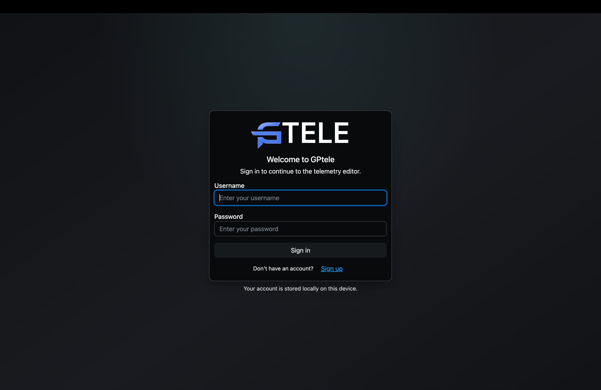
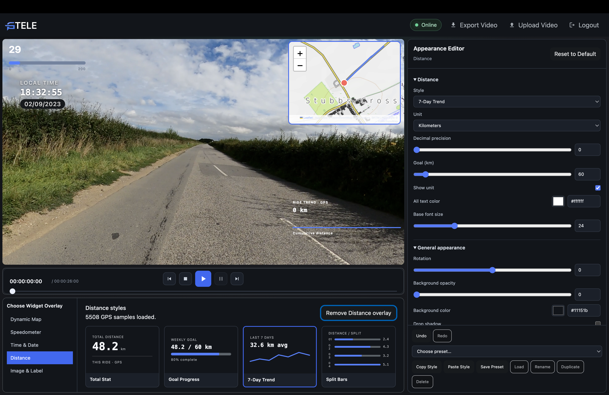

# GPTele

GPTele is a desktop application for adding GoPro telemetry overlays to video. It reads GPS data from video, displays a map and metrics that follow the video timeline, and exports the result as an MP4.




## Features

- Play video and sync overlays with the current playback position.
- Add a GPS route map, speedometer, time and date, distance, or an image with a label.
- Adjust widget position, size, colors, opacity, and appearance. Use undo/redo and save widget presets.
- Export MP4/H.264 video at the source resolution, 720p, 1080p, 1440p, or 4K. Choose the frame rate, quality, and whether to include audio.
- Create local accounts on the device. GPTele does not use a cloud account for sign-in.

GPS data is available when the selected GoPro video contains GPS telemetry that GPTele can read. Videos without GPS data can still be played, but GPS-dependent widgets will not have telemetry to display.

## Download GPTele

Visit [GitHub Releases](https://github.com/romimeimedio16/GPTele/releases/latest) to download the latest version.

### macOS: DMG or Homebrew

Download `GPTele-1.0.0.dmg` from the release page, open the DMG, then drag `GPTele.app` to the **Applications** folder.

> The current macOS build is not signed or notarized with an Apple Developer ID certificate. macOS may show a warning the first time you open the app.

To install with Homebrew, this repository also provides a cask. Run:

```bash
brew tap romimeimedio16/GPTele https://github.com/romimeimedio16/GPTele
brew install --cask gptele
```

If Homebrew asks you to trust the tap, review [`Casks/gptele.rb`](Casks/gptele.rb), trust the cask, then retry the installation:

```bash
brew trust --cask romimeimedio16/gptele/gptele
brew install --cask gptele
```

Update a Homebrew installation with:

```bash
brew upgrade --cask gptele
```

Uninstall GPTele with:

```bash
brew uninstall --cask gptele
```

To remove the tap from your Homebrew configuration:

```bash
brew untap romimeimedio16/gptele
```

### Windows

Download `GPTele-1.0.0-setup.exe` from the [v1.0.0 release](https://github.com/romimeimedio16/GPTele/releases/tag/v1.0.0), then run the installer.

> **Architecture:** The Windows installer in release v1.0.0 is built for ARM64. Windows x64 users should wait for an x64 build. The installer is also unsigned, so Windows may show a security warning.

You can uninstall the app from Windows Settings or by using the uninstaller shortcut created by the installer.

## Getting started

1. Open GPTele and sign in with a local account.
2. On a fresh installation, sign in with username `admin` and password `admin`.
3. GPTele will ask you to change the admin password. Set a new password before continuing.
4. Select **Upload Video** and choose a GoPro video.
5. Choose a widget, enable its overlay, and position it over the video.
6. Customize the widget in the **Appearance Editor**.
7. Select **Export Video**, choose the output settings, and select where to save the video.

> Accounts and passwords are stored locally on the device. Change the default password before using the app, and do not reuse a password from another account.

## Updates

Download the latest version from [GitHub Releases](https://github.com/romimeimedio16/GPTele/releases/latest). If you installed GPTele with Homebrew, run `brew upgrade --cask gptele`.

GPTele does not currently show in-app update notifications or update itself. Check the Releases page or use the Homebrew command to get a newer version.

## npm installation

`npm install` installs dependencies for development. It does not install the ready-to-use desktop app. To install GPTele, use the DMG, Windows installer, or Homebrew on macOS.

## Run from source

### Requirements

- Node.js and npm.
- A C compiler to build the native telemetry reader. On macOS, install Xcode Command Line Tools. On Windows, use a C compiler that provides `cl.exe`.

### Setup and development

```bash
git clone https://github.com/romimeimedio16/GPTele.git
cd GPTele
npm install
npm run dev
```

### Build the app

```bash
# Build macOS for the current machine architecture
npm run build:mac

# Build Windows for the architecture supported by the current machine/compiler
npm run build:win

# Build Linux
npm run build:linux
```

Packaged artifacts are written to the `dist/` folder. To distribute a Windows x64 build, build on Windows x64 or explicitly set the target architecture, then test the installer on a Windows x64 device.

Run type checks with:

```bash
npm run typecheck
```

## Privacy and local data

App accounts are stored locally on the device. GPTele processes the selected video to read telemetry and create the export. Maps use tiles from the selected map provider, so an internet connection may be required to load map tiles.

## License

GPTele is distributed under the MIT License. See [`LICENSE`](LICENSE).
